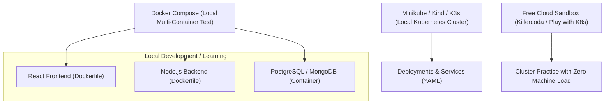

# Forward Engineering Plan & Roadmap: Codeial

This document outlines the architectural roadmap and planned enhancements for future iterations of Codeial.

---

## Phase 1: Backend Architecture & Database

### Option A: Serverless Backend on Vercel (Fastest & Free)
- Implement `/api/posts`, `/api/users`, and `/api/auth` using Vercel Serverless Functions (`api/` folder).
- Keep frontend and backend deployed under the same domain (`codeial-social.vercel.app/api/...`), eliminating CORS overhead.
- Database: Supabase PostgreSQL or MongoDB Atlas (free tiers).

### Option B: Standalone Node.js / Express Backend
- Create an independent Express REST API repository or monorepo folder.
- Deploy for free on **Render** or **Railway**.
- Decoupled from the Vercel frontend: frontend simply reads `process.env.REACT_APP_API_URL`.

---

## Phase 2: Learning Docker & Kubernetes (Zero Cost Setup)

### Goal: Containerize and Orchestrate Codeial for Resume & DevOps Learning

### 1. Docker Implementation
1. **Frontend Dockerfile**: Multi-stage build (Node build stage → Nginx alpine image serving static `/build`).
2. **Backend Dockerfile**: Lightweight Node Alpine image.
3. **docker-compose.yml**: Orchestrate Frontend, Backend, and Database on a single local network.

### 2. Free Kubernetes Learning Options (No Personal Machine Load)
- **Killercoda (killercoda.com)**: Free browser-based interactive Kubernetes clusters running Ubuntu 22.04 with standard `kubectl`.
- **Play with Kubernetes (labs.play-with-k8s.com)**: Free Docker-sponsored interactive K8s sandbox.
- **Local Alternative (Lightweight)**: `k3d` or `Kind` (Kubernetes in Docker), consuming significantly fewer resources than Minikube.

---

## Phase 3: Feature Enhancements

### 1. Real-Time Chat Revival (Optional)
- Replace legacy Socket.io client with Supabase Realtime or Pusher (free tier, no persistent Node WebSocket server needed).
- Real-time direct messaging between active connections.

### 2. Recruiter Analytics Dashboard
- Private `/admin` or `/recruiter-stats` route displaying visit counts by source (`naukri`, `linkedin`, `resume-frontend`, `resume-fullstack`) and geographic heatmap.

### 3. Post Feed Enhancements
- Image uploads via Cloudinary / Supabase Storage.
- Pagination or infinite scrolling for mock and live posts.
- Comment threading and reaction emojis.

---

## Summary Checklist for Next Session
- [ ] Connect custom backend endpoint via `REACT_APP_API_URL`.
- [ ] Add Dockerfile and docker-compose configurations.
- [ ] Implement Vercel serverless API or Render backend.
- [ ] Wire Supabase authentication and database models.
