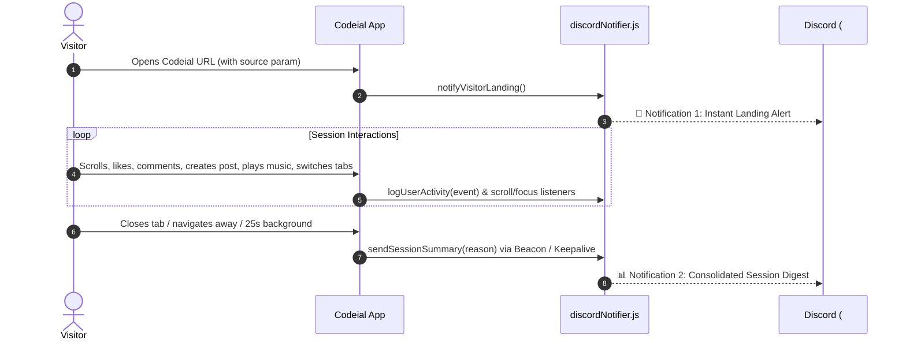

# Project Summary: Codeial Social Media Platform

## 1. Project Overview & Context
- **Repository:** [neelesh0406/codeial-react-social-media](https://github.com/neelesh0406/codeial-react-social-media)
- **Live Deployment:** [https://codeial-social.vercel.app/](https://codeial-social.vercel.app/)
- **Core Stack:** React 17.0.2, Redux 4.1.1, React Router 5.3.0, Create React App (CRA).
- **Core Objective:** Revive and modernize an older React social media repository for resume and recruiter showcases with zero breaking migrations, ensuring instant visual appeal, ambient music, live simulation, and real-time visitor tracking.

---

## 2. Key Accomplishments

### A. Build & Tooling Stabilization
- Configured Node 22 OpenSSL legacy provider compatibility (`NODE_OPTIONS=--openssl-legacy-provider`) in `package.json`.
- Removed deprecated `react-app/jest` overrides resolving ESLint/Jest environment errors.
- Added `.npmrc` (`node-linker=hoisted`) and `pnpm-lock.yaml` for stable builds.
- Added `vercel.json` with client-side SPA rewrites to eliminate 404s on page refresh.

### B. Smart Geolocation Audio Player (`MusicPlayer.js`)
- Integrated IP-based regional track selection via `ipwho.is`:
  - **South India (`KA`, `TN`, `KL`, `TS`, `AP`, `PY`) & Global:** English track (*Cheri Cheri Lady*).
  - **North / Rest of India:** Hindi track (*Russian Bandana*).
- **Audio Autoplay & Volume Control:**
  - Strictly capped volume at **50% (`0.5`)** with metadata and change clamping.
  - Transparent autoplay fallbacks: tries unmuted playback; if browser policy blocks it, falls back to muted autoplay and seamlessly unmutes on the first interaction (`pointerdown`, `click`, `scroll`, `keypress`).
  - Red close button (`✕`) immediately halts playback, resets time, and minimizes to a floating note button.

### C. Recruiter & Reference URL Tracking (Silent Intelligence)
- **Removal of Visible Welcome Banner:**
  - Removed the visible query parameter banner ("👋 Naukri Hiring Team", "👋 LinkedIn Recruiter", etc.) from the feed UI to keep the platform look 100% natural, authentic, and uncluttered.
- **Silent Background Parameter Extraction:**
  - Silently parses `?source=`, `?ref=`, `?utm_source=`, and `?v=` on landing (supporting `naukri`, `linkedin`, `resume-frontend`, `resume-fullstack`, etc.).
  - Persists source attribution in `sessionStorage` (`codeial_ref_source`) without any visual tracking banner or UI disruption.
  - Automatically enriches the real-time Discord telemetry pipeline with the visitor's origin.

### D. Strict 2-Notification Discord Telemetry Architecture (`discordNotifier.js`)
The Discord notification system was re-architected into a strict, noise-free **2-notification model**:

1. **Notification 1: Instant Landing Alert (Dispatched within 1-2s of load)**
   - 🎯 Candidate source / recruiter referral origin (`naukri`, `linkedin`, `resume`, `organic`).
   - 📍 Geolocation: City, State, Country, Postal Code via `ipwho.is`.
   - 🏢 Corporate Network / ISP / Autonomous System (identifies enterprise VPNs / office networks).
   - 📱 Device details: OS, browser engine, screen resolution, mobile vs. desktop viewport.
   - ⏰ Exact timestamp with anti-spam session de-duplication (`codeial_landing_notified`).

2. **Notification 2: Consolidated Session Digest (Dispatched once upon departure)**
   - ⏱️ **Session Duration Breakdown:** Total wall-clock time, **Active Focus Time** (tab in foreground), and Backgrounded Time.
   - 📜 **Scroll Depth:** Maximum % scrolled with milestone triggers (25%, 50%, 75%, 100% bottom of feed).
   - 👁️ **Actually Viewed Verdict:** High-confidence engagement tag:
     - 🔥 **Deep Engagement** (≥ 30s active focus + interactions)
     - 📖 **Focused Reading** (≥ 15s active focus)
     - ⚡ **Quick Glance** (< 15s active focus)
     - ⚠️ **Background Tab Only** (left immediately or minimal focus)
   - 🖱️ **User Activity Timeline:** Chronological micro-action log (up to 18 events formatted in a code block) detailing exact actions taken.
   - 🚀 **100% Guaranteed Dispatch:** Uses `navigator.sendBeacon` and `fetch(..., { keepalive: true })` on `pagehide` and `beforeunload`, plus a 25-second continuous background tab trigger and 5-minute milestone fallback.

### E. Full Custom Events Instrumentation
Micro-action tracking is integrated across core platform components via `logUserActivity()`:
- **`MusicPlayer.js`:** Audio start, pause, unmute, track switching (*Cheri Cheri Lady* ↔ *Russian Bandana*), and player close/minimize.
- **`CreatePost.js`:** Post formatting toolbar usage (Bold, Italic, Quote) and post submission events.
- **`Post.js`:** Post likes, comment toggles, comment submissions, and author profile clicks (`Osho`, `Elon Bhadwa`, `Neelesh`).
- **`Navbar.js`:** Search bar queries and search result profile link clicks.
- **`FriendsList.js`:** Sidebar connection profile clicks and "Login to add friends" prompt clicks.

### F. Feed Polish & Simulated Activity
- **Safe Markdown Rendering:** Custom parser in `Post.js` supports `**bold**`, `*italic*`, and `> blockquotes` with 0 XSS risk.
- **Live Feed Simulation:** Injects an Osho quote post after 3.5s with an audible notification pop chime.
- **Floating Typing Badge:** Glassmorphic badge cycling every 6s with zero layout shift.
- **Reference Users:** Enforced reference users strictly: `Osho`, `Elon Bhadwa`, and `Neelesh (Author)`.

### G. Layout, Design System & Brand Identity
- CSS design system with `:root` variables in `App.css`.
- Header baseline alignment between "Posts" and "Connections".
- Sidebar width tightened to 220px, eliminating excess whitespace.
- Updated browser tab title to `Codeial | Social Networking Platform`.
- Replaced default React favicon with custom sunset gradient Codeial SVG squircle (`public/favicon.svg`).
- Cleaned `README.md` to showcase the live demo link and visual feature GIFs.
